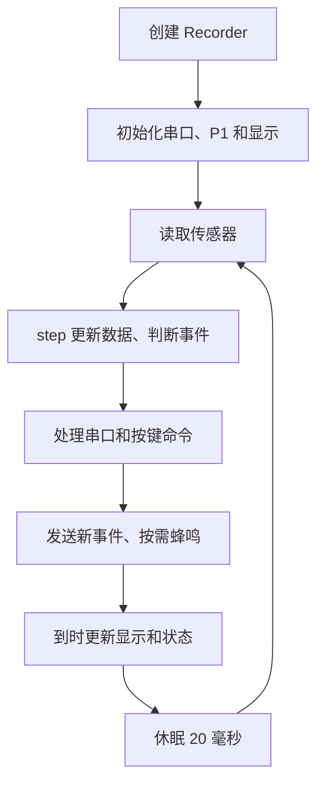

# 易碎品运输记录系统：板上代码关键阅读与答辩速查

答辩日期：2026 年 10 月 22 日。整理日期：2026 年 10 月 21 日。

阅读对象：[firmware/parcel_mu.py](/D:/Users/lenovo/Desktop/micro_py/firmware/parcel_mu.py)，当前共 179 行。以下行号对应这个单文件版；四文件版的核心逻辑相同。

## 1. 先记住这段介绍

> 本项目用 micro:bit 实现易碎品运输过程的异常记录。板载加速度计检测冲击和持续倾斜，P1 接碰撞开关模拟箱盖状态，P2 电位计选择灵敏度，P0 蜂鸣器提示异常。程序保存三类事件的累计次数和最近 16 条详情，通过 USB 串口与电脑界面通信。板上按 A 开始或结束，按 B 切换提示音；记录保存在内存中，需要通过电脑导出留存。

### 时间有限时，按这个顺序看

| 阅读顺序 | 代码位置 | 必须能回答的问题 |
|---|---|---|
| ① 入口和主循环 | [178 行](/D:/Users/lenovo/Desktop/micro_py/firmware/parcel_mu.py:178)、[138 行](/D:/Users/lenovo/Desktop/micro_py/firmware/parcel_mu.py:138) | 程序从哪里启动？一轮循环做什么？ |
| ② 开始、结束与状态 | [42 行](/D:/Users/lenovo/Desktop/micro_py/firmware/parcel_mu.py:42) | 如何开始运输？为什么要先合盖、放稳？ |
| ③ 三类事件判定 | [75 行](/D:/Users/lenovo/Desktop/micro_py/firmware/parcel_mu.py:75) | 为什么不会每次采样都重复报警？ |
| ④ 记录与读取 | [30 行](/D:/Users/lenovo/Desktop/micro_py/firmware/parcel_mu.py:30)、[116 行](/D:/Users/lenovo/Desktop/micro_py/firmware/parcel_mu.py:116) | 事件怎么存？电脑怎么读？ |
| ⑤ 答辩边界和演示 | 本文第 7～9 节 | 实现到了哪一步？怎样准确展示？ |

**最值得讲的设计：状态管理、开关消抖、冲击回差和间隔、倾斜持续时间和恢复角度、固定数量的事件缓存。**

## 2. 硬件输入、输出和软件分工

| 硬件 | 代码中的读写方式 | 用途 |
|---|---|---|
| 板载三轴加速度计 | `m.accelerometer.get_values()` | 获取 x、y、z，用于冲击和相对姿态判断 |
| P1 碰撞开关 | `m.pin1.read_digital()` | 模拟合盖、开盖；默认合盖为 1 |
| P2 电位计 | `m.pin2.read_analog()` | 读取 0～1023，启运时选择三档灵敏度 |
| P0 扩展板蜂鸣器 | `music.pitch(..., pin=m.pin0, wait=False)` | 新事件产生时短音提示 |
| A / B 按键 | `was_pressed()` | A 开始或结束；B 静音或恢复 |
| LED 点阵 | `m.display.show(screen)` | 显示灵敏度、运输状态或最近事件类型 |
| USB 串口 | `m.uart` 和 `print()` | 接收命令，发送状态、事件和记录快照 |

代码按职责可以分成四部分，即使合并成一个文件，阅读时也这样理解：

- `Recorder`：保存状态、采样数据、事件，执行检测规则。
- `command()`：接收统一的命令，控制开始、结束、静音和读取。
- `run()`：连接真实硬件，持续采样、检查按键、收发串口和更新显示。
- 文件最后两行：创建记录器并进入主循环。

**板端完成检测与内存记录；电脑端完成界面展示和 CSV / JSON 导出。板端本身不会生成 CSV 文件。**

## 3. 程序从哪里开始，一轮循环做什么

### 3.1 真正的入口：178～179 行

```python
r=Recorder()
run(r)
```

`r` 是记录器对象。类定义和函数定义先被加载，执行到这里才创建对象、进入持续运行的主循环。

### 3.2 初始化：17～28 行、139～145 行

`Recorder.__init__()` 设置待机状态 `I`、空记录、零计数及默认参数。`run()` 初始化 115200 波特率串口，将 P1 设置为下拉输入，开启 LED，并发送启动消息。

`pin` 和 `raw` 初值是 `-1`，表示尚未取得经过消抖的有效电平；不是第三种真实开关状态。

### 3.3 主循环：146～175 行

每轮按以下顺序执行：

1. 读取开机毫秒数、电位计、三轴加速度和开关电平。
2. 调用 `r.step(...)` 更新采样数据并判断事件。
3. 处理串口命令，再处理 A、B 按键。
4. 若出现新事件，发送 `@E` 消息，并按静音状态决定是否响铃。
5. 到达上报时间时，刷新 LED，发送 `@S` 状态并执行垃圾回收。
6. `m.sleep(20)`，然后进入下一轮。



**答辩说法：**“程序用一个循环轮询多个任务。传感器每轮读取，倾角约每 100 毫秒更新，状态和显示约每 250 毫秒更新。蜂鸣使用非阻塞播放，避免等待提示音结束再采样。”

注意：20 毫秒只是休眠时间，一轮还包含计算、串口和垃圾回收，因此不能说“严格 50 Hz 采样”。`wait=False` 只说明蜂鸣播放不阻塞，整个程序仍会受到其他操作耗时影响。

## 4. 开始、结束、状态与灵敏度

### 4.1 状态不是事件类型

| `r.state` | 含义 | 何时进入 |
|---|---|---|
| `I` | 待机 | 上电初始化，或未运输时完成开盖标定 |
| `R` | 正在监测 | `START` 成功 |
| `V` | 已结束，查看记录 | `STOP` 成功 |
| `O` | 等待确认开盖标定 | 执行 `CAL_CLOSE` 后 |

常规过程为 `I → R → V → R`。从 `V` 再开始会清除上一趟记录。

事件中的 `O` 代表“开箱”，状态中的 `O` 代表“等待开盖标定”，看它处于哪个字段即可区分。

### 4.2 `START` 做了什么：52～68 行

```python
if self.pin!=self.closed:
    return 'CLOSE_LID'
self.base=self.xyz
self.g0=max(1,self.strength)
self.mode=min(2,pot*3//1024)
```

先确认消抖后的开关为合盖状态，再把最近一次采样的三轴向量作为初始方向 `base`，把该向量的模长作为 `g0`。随后锁定灵敏度和阈值，运输编号加一，记录起始时间，清空旧记录和检测标志，进入 `R`。

**为什么放稳后再开始？** 当前代码直接采用启运时的一次采样作为基准，没有多次平均或自动等待静止的过程。开始时如果正在晃动，会影响基准方向与幅值。

### 4.3 电位计如何变成三档

| `pot` 读数 | `mode` | 待机 LED | 灵敏度 | 本配置冲击阈值 |
|---|---|---|---|---|
| 0～341 | 0 | 1 | 低 | 1750，约为初始幅值的 1.75 倍 |
| 342～682 | 1 | 2 | 中 | 1500，约为初始幅值的 1.50 倍 |
| 683～1023 | 2 | 3 | 高 | 1250，约为初始幅值的 1.25 倍 |

阈值越低，越容易触发，所以“高灵敏度”的阈值反而较低。运输过程中虽然仍读取电位计，但 `mode` 和 `limit` 不会随之更新，要等下一次 `START` 才重新锁定。

`sensor_range` 默认值为 2，当前走 `(1750,1500,1250)` 分支。代码中的另一个阈值表是预留分支；**这个参数本身没有调用硬件接口设置加速度计量程。**

### 4.4 `STOP` 与合盖标定

- `STOP` 在 `R` 状态下记录持续时间，切换为 `V`，保留事件供电脑读取。
- `CAL_CLOSE` 在非监测状态下记住当前电平作为合盖值，进入标定状态。
- `CAL_OPEN` 检查当前电平是否与合盖值不同；不同才确认完成。

合盖标定只改变开关电平的解释，不标定加速度，也不写入掉电保存的配置文件。

## 5. 核心：三类事件如何判定

### 5.1 共同基础：加速度合量与归一化

位置：78 行、90～91 行。

```python
self.strength=int(sqrt(x*x+y*y+z*z))
g=self.strength*1000//self.g0
self.peak=max(self.peak,g)
```

用三轴向量的模长描述采样加速度大小，避免仅观察某一轴而受放置方向影响。再除以启运时的基准幅值 `g0`，以千分数形式表示，静止且接近基准幅值时约为 1000。

这里变量 `g` 是归一化后的整数，不是 9.8，也不是力的单位。电脑显示时除以 1000。该数值近似表示相对于启运重力幅值的加速度倍数，不能把它当成经过精密标定的测量结果。

### 5.2 冲击：92～97 行

```python
if g>=self.limit and not self.high and now>=self.ready:
    self.event('S',now,g)
    self.high=True
    self.ready=now+500
if g<self.limit*85//100:
    self.high=False
```

触发必须同时满足三项：达到阈值、尚未处于本次高加速度状态、已到允许再次触发的时间。

- `high` 锁住本次超阈值过程，持续超限不会每轮计一次。
- 低于触发阈值的 85% 才解除锁定，形成回差，减少临界值附近反复计数。
- `ready` 额外要求两次触发之间至少相隔 500 毫秒。

例：中档阈值为 1500。采样达到 1800，记录一次；持续保持 1800 不会重复记录。必须先降到 1275 以下，并且距离上次触发至少 500 毫秒，之后再次达到 1500 才能计下一次。

**两个不同的数：**`event('S',now,g)` 保存首次越过阈值时的采样值；`peak` 保存本趟运输监测到的最大采样值。事件值不一定等于峰值。

### 5.3 持续倾斜：98～111 行

```python
dot=(x*self.base[0]+y*self.base[1]+z*self.base[2])/(max(1,self.strength)*self.g0)
self.angle=int(acos(max(-1,min(1,dot)))*57.2958)
```

这是向量夹角公式：

```text
cos(θ) = 当前加速度向量 · 初始向量 /（当前向量模长 × 初始向量模长）
θ = arccos(cos(θ)) × 180/π
```

`57.2958` 约等于 `180/π`，将弧度转换为度；将 `dot` 限制在 `[-1,1]`，避免数值误差让 `acos()` 超出定义域。`max(1,...)` 用于避免除以零。

倾角相对于**启运时的姿态**，不是固定相对于桌面。若一开始斜着放并保持静止，那个方向就是本趟的参考姿态。这个算法也不能完整识别三维旋转，例如绕重力方向旋转通常不会改变重力向量方向。

记录倾斜事件还要满足：

1. 归一化幅值处于 800～1200，即接近初始重力幅值，减少明显动态加速度的干扰。
2. 相对夹角达到 45°。
3. 以上条件连续满足约 2000 毫秒。
4. 本轮倾斜尚未被记录。

短暂倾斜或幅值超出区间会重置持续计时。记录后 `tilt=True` 防止持续倾斜反复计数；回到 35°以内才重新允许下一次倾斜事件。

**答辩说法：**“我组合使用角度阈值、持续时间和恢复角度，过滤短暂晃动，并避免一次持续倾斜重复报警。接近 1g 的条件只能减少动态干扰，不能保证完全消除误判。”

### 5.4 开箱：79～86 行

```python
if switch!=self.raw:
    self.raw=switch
    self.changed=now
if now-self.changed>=60 and self.pin!=switch:
    old=self.pin
    self.pin=switch
    if self.state=='R' and old==self.closed and switch!=self.closed:
        self.event('O',now,switch)
```

机械触点切换时可能在 0、1 之间短暂抖动。程序每次发现原始电平变化就重新记时，连续稳定至少 60 毫秒才更新有效电平 `pin`。

只在运输中、且从合盖变为开盖时计一次。一直开着不会重复计数；重新合上再打开，才可能产生下一次事件。

**这里外接碰撞开关用于模拟箱盖，冲击来自板载加速度计，两者的任务不同。**

## 6. 数据如何保存，怎样发给电脑

### 6.1 重点变量速查

| 变量 | 含义 |
|---|---|
| `state` / `trip` | 运行状态 / 本次通电期间的运输编号 |
| `start` / `duration` | 启运时的开机毫秒数 / 运输已持续的毫秒数 |
| `xyz` / `base` | 当前三轴向量 / 启运参考向量 |
| `strength` / `g0` | 当前向量模长 / 启运参考模长 |
| `mode` / `limit` | 已锁定的灵敏度档位 / 冲击阈值 |
| `counts` | `[冲击次数, 倾斜次数, 开箱次数]` |
| `n` / `events` | 本趟事件总数 / 最多 16 条事件详情 |
| `raw` / `pin` / `closed` | 原始开关值 / 消抖后的值 / 合盖对应电平 |
| `high` / `ready` | 冲击锁定标志 / 最早允许再次触发的时刻 |
| `tilt` / `tilt_at` | 本轮倾斜是否已记录 / 本轮持续倾斜计时起点 |
| `s[0]` | 静音标志；为真时跳过新事件蜂鸣，检测仍运行 |

`high`、`ready`、`base` 等部分变量在 `START` 时建立，`step()` 中对应逻辑受 `state=='R'` 保护，因此待机阶段不会提前使用它们。

### 6.2 事件缓存：30～40 行

```python
k='STO'.index(kind)
self.n+=1
self.counts[k]+=1
if len(self.events)==MAX_EVENTS:
    self.events.pop(0)
self.events.append((now-self.start,k*65536+value))
```

- `'STO'` 将冲击、倾斜、开箱分别编码为 0、1、2。
- 每条详情保存 `(启运后毫秒数, 类型编码×65536+数值)`，用较紧凑的结构存储。
- `record()` 用整除和取余恢复类型与数值。这个编码隐含数值需位于 `0～65535`；当前正常采样用途下按该范围使用。
- 超过 16 条时删除最旧一条，累计次数与总数继续增加。

例如共有 20 次事件，详情仍只有最近 16 条，其事件编号为 5～20。`n-len(events)+i+1` 正是这样恢复序号。

这是**限长列表缓存**，`pop(0)` 会移动后面的元素；不要讲成已实现了循环数组或掉电保存。

### 6.3 统一命令入口：116～130 行

电脑串口指令和板上按键都会进入 `command()`，因此同一种操作共用处理逻辑。

| 命令 | 行为 |
|---|---|
| `START` / `STOP` | 交给 `r.cmd()` 开始或结束 |
| `CAL_CLOSE` / `CAL_OPEN` | 标定开关的合盖、开盖电平 |
| `MUTE` | 切换提示音开关 |
| `DUMP` | 输出摘要、保留的事件详情、结束标志 |
| `SAVE` | 返回 `RAM_ONLY`，表示基础版没有板端持久保存 |

串口按换行符分割命令；不完整的一行暂存在 `rx`，缓冲超过 96 字节时清空。当前实现针对简短、约定格式的命令，不包含完整的异常输入恢复机制。

### 6.4 消息前缀

| 前缀 | 用途 |
|---|---|
| `@HELLO` | 板端程序启动标识及配置 |
| `@S` | 周期状态，包括状态、编号、时长、加速度、角度、开关、电位计和计数等 |
| `@E` | 新事件即时通知 |
| `@A` | 命令处理结果，如 `STARTED`、`CLOSE_LID` |
| `@D` | 读取记录时的摘要 |
| `@R` | 读取记录时的一条事件详情 |
| `@DONE` | 本次记录输出结束 |

示例（只解释字段，**不是实测记录**）：

```text
@E,1,3,5200,T,52
```

表示第 1 趟运输、第 3 个事件、启运后 5200 毫秒、持续倾斜事件、记录角度 52°。时间是相对启运时间，不是现实日期和时刻。

## 7. 实现边界与已有验证

### 答辩中要准确说明的边界

| 容易说错的点 | 当前代码实际做到的事 |
|---|---|
| “测出了冲击力” | 检测采样加速度异常，没有计算力，也没有输入货物质量 |
| “每次冲击都能测到” | 轮询采样可能漏掉很短的脉冲，超量程也会影响数值 |
| “倾斜就是绝对倾角” | 计算相对于启运方向的夹角，动态加速度可能干扰 |
| “自动静止校准” | 当前基础版启动时取一次采样作为基准，依靠操作时放稳 |
| “结束后自动永久保存” | 结束后留在 RAM；断电、重启、新一趟开始会丢失旧记录 |
| “保存全部事件” | 累计次数继续增加，详情只保留最新 16 条 |
| “代码中设置了 ±2g 量程” | 当前按默认 2 的配置选择阈值表，没有量程设置调用 |
| “整机已验证所有功能” | 应区分逻辑测试、打包检查和真实硬件运行测试 |

### 当前可引用的验证证据

- 单文件版的 `Recorder`、`command()`、`run()` 已与四文件版对应代码做语法树一致性检查。
- 单文件版的检测类通过原有 8 项测试，覆盖合盖前置条件、电平标定、短暂倾斜过滤、持续倾斜及恢复、冲击回差与间隔、开关消抖、缓存上限、结束和重新开始。
- 单文件版通过本机 Mu 1.2.0 的脚本及 HEX 打包检查。
- 2026 年 10 月 21 日，四文件版曾在更换后的板上通过文件读回校验、启动检查、连续状态接收和空记录读取。
- **生成单文件版时没有检测到开发板连接，因此当前尚无单文件版的真实上板运行验证。打包成功不能代替上板验证。**

对应记录：[单文件检查结果](/D:/Users/lenovo/Desktop/micro_py/verification/parcel_mu_verification/results.json)、[新板部署验证](/D:/Users/lenovo/Desktop/micro_py/verification/new_board_deploy_20261021/verification.json)。

`gc.collect()` 用于回收已不再使用的对象，不能保证永远没有内存不足。`micropython.opt_level(3)` 涉及后续编译的优化；对同一个已经编译完成的单文件，不能宣称执行这一行就会重新优化其中所有函数。答辩讲内存设计时，应重点讲限长缓存和紧凑的事件结构。

## 8. 老师可能追问的 12 个问题

### 1. 为什么使用三轴合量，不只判断 z 轴？

运输箱可能改变放置方向。单轴分量会随方向变化，三轴合量更适合描述当前采样加速度大小；但它仍包含重力，不能直接等同于纯运动加速度。

### 2. 为什么以启运姿态作为参考？

箱体初始摆放不一定水平。用启运方向作为参考，更适合判断本趟运输中姿态发生了多大变化。

### 3. 冲击为什么需要 85% 和 500 毫秒两层条件？

85% 回差要求信号真正回落，避免阈值附近抖动重复计数；500 毫秒间隔限制短时间内的连续触发。它们处理的是不同的问题。

### 4. 为什么 45°、2 秒、35°？

当前设计以 45°作为明显偏离参考姿态的阈值，2 秒过滤短暂晃动，35°作为恢复阈值形成回差。这些是课程原型参数，后续可以结合不同包装和运输试验调整，不能说是所有易碎品通用的行业标准。

### 5. 为什么电位计运行中转动没有改变阈值？

程序在 `START` 时锁定档位，保证一趟运输使用一致的判定标准。下一趟开始时才重新读取档位。

### 6. 怎么防止机械开关重复触发？

等待原始电平稳定至少 60 毫秒，再更新有效电平；并且只记录合盖到开盖的变化，而不是持续统计开盖电平。

### 7. 为什么最多只保存 16 条？

micro:bit V1 的内存有限，限长缓存能控制事件详情占用。超过上限仍保留累计次数，详情淘汰最旧记录。这是容量和资源占用之间的取舍。

### 8. 为什么不用每次异常都写入文件？

当前基础版选择内存记录以简化板端逻辑，并减少运行中的文件写入工作。代价是不能掉电恢复，需在断电前导出。持久保存可以作为后续改进。

### 9. 一个循环怎样同时采样、通信和报警？

按轮询顺序快速执行各项工作，按时间戳控制较低频的倾角更新和状态上报，蜂鸣采用非阻塞播放。没有使用多线程，任务耗时仍会影响实际循环周期。

### 10. 为什么按键和电脑控制可以保持一致？

两种输入都调用同一个 `command()`，开始、结束等状态操作最终由同一个 `r.cmd()` 执行，避免维护两套规则。

### 11. 冲击记录是峰值吗？能否判断物品损坏？

单条冲击事件保存的是首次越过阈值的采样值，全程最大采样值单独保存在 `peak`。这些数据可以辅助追溯异常，不能仅凭它们证明物品已经损坏。

### 12. 下一步最值得改进什么？

可以选择三点回答：增加静止多次采样校准；提高对短促冲击的捕获能力；加入掉电保存。若用于实际运输，还需要通过实测评估误报、漏报和参数适用范围。

## 9. 明天演示与三分钟讲解稿

### 演示前先确认

1. 若演示单文件版，先在 Mu 的 BBC micro:bit 模式刷入并做完整试运行，确认启动后 LED 显示 1 / 2 / 3。
2. 打开电脑端运输记录器前，关闭 Mu 的 REPL / 绘图器，释放串口；选择实际枚举出的端口，最近一次已验证端口为 COM42。
3. 检查 P1 开关电平能变化、P2 电位计读数能变化，确认扩展板蜂鸣器开关打开。
4. 需要保留的数据先导出；重新刷入、重启、开始下一趟都会影响旧的 RAM 记录。

### 建议演示顺序

| 操作 | 应看到什么 | 同时解释什么 |
|---|---|---|
| 待机转动电位计 | LED 在 1 / 2 / 3 间改变 | 档位在开始时锁定 |
| 按住开关，将板放稳，再按 A | 进入运输监测 | 先验证合盖，再保存参考向量 |
| 保持开关合盖，倾斜超过约 45°并保持 2 秒以上 | 倾斜次数增加，显示 T | 持续时间过滤短暂晃动 |
| 保持倾斜不动，再恢复至 35°以内 | 一次持续倾斜不会反复累计 | 恢复阈值用于重新允许检测 |
| 松开开关，并保持稳定超过 60 毫秒 | 开箱次数增加，显示 O | 消抖与合盖到开盖的边沿判断 |
| 按 B 后再制造一次事件 | 仍有事件记录，后续提示音关闭 | 静音不关闭检测 |
| 按 A 结束，电脑读取并导出 | 能查看摘要和事件，生成 CSV / JSON | 内存记录通过电脑持久留存 |

冲击演示可在高灵敏度档位另开一趟，用手持板做一次适度、短促的运动，先预演确认能越过阈值。三种事件可能同时产生，例如移动板时兼有倾斜与冲击；应结合电脑上的分类计数解释，LED 只显示最近事件。

### 三分钟讲解稿（按自己的语速调整）

> 我的课题是易碎品运输异常记录。系统关注冲击、持续倾斜和开箱三类事件，板端负责采样、判断和记录，电脑端负责显示与导出。
>
> 程序从最后两行开始，先创建 Recorder 对象，再进入 run 主循环。每轮读取加速度、开关和电位计，调用 step 进行判断，然后处理按键与串口命令，最后更新事件通知和显示。
>
> 开始运输前要求合盖，并将板放稳。开始时保存当前重力方向和幅值作为参考，同时用电位计选择并锁定灵敏度。这样一次运输的判定标准保持一致。
>
> 冲击检测先计算三轴加速度合量，再相对于启运幅值归一化。超过阈值记录一次，之后需要信号回落到阈值的 85% 以下，并满足 500 毫秒间隔，才允许下一次触发，避免一次持续超限反复计数。
>
> 倾斜检测用当前向量和初始向量的夹角，要求达到 45 度、加速度幅值接近基准，并持续约 2 秒才记录；恢复到 35 度以内才允许再次记录。开箱检测则对 P1 做 60 毫秒消抖，只记录合盖变成开盖的过程。
>
> 为适应板端内存限制，程序累计三类事件次数，只保留最近 16 条详情。按键和电脑指令共用命令入口，电脑通过串口读取摘要与事件，再导出文件。
>
> 当前原型的限制是记录保存在内存，短促冲击可能漏采，运动也会干扰倾角。因此这些记录用于异常追溯，不能直接判定货物损坏。后续可以增加多次采样校准、提高冲击捕获能力，并加入掉电保存。

### 上台前最后记住这组数字

**P1 开关、P2 电位计、P0 蜂鸣器；60 毫秒消抖；500 毫秒冲击间隔；85% 冲击恢复；45°持续 2 秒、35°恢复；16 条详情；约 100 毫秒更新倾角、250 毫秒上报状态；每轮末尾休眠 20 毫秒。**
